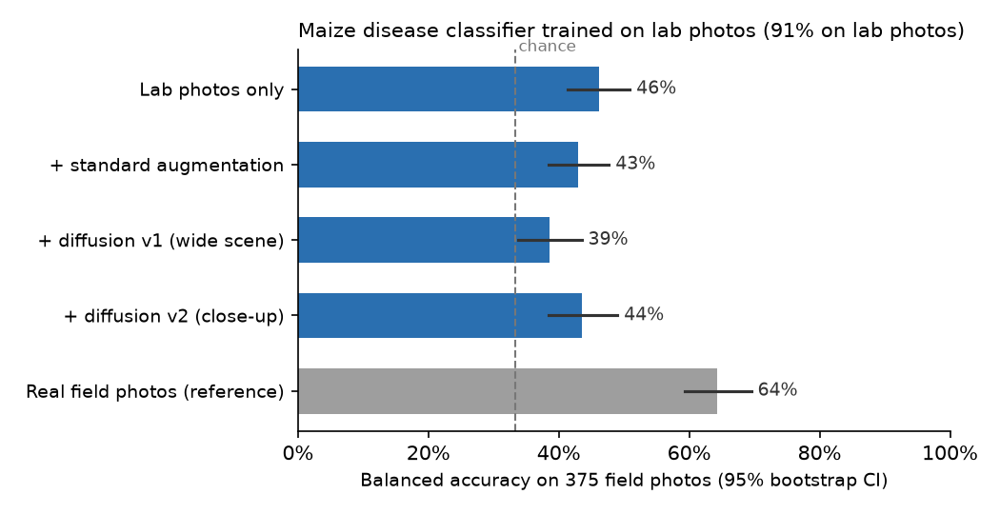

# Can diffusion move a maize disease model from the lab to the field?

A small experiment inspired by Tan, Beck, Bidinosti, Gulden and Henry, "Generative diffusion models for agricultural AI: plant image generation, indoor-to-outdoor translation, and expert preference alignment" ([arXiv:2512.19632](https://arxiv.org/abs/2512.19632)).

The question: a classifier trained on lab photos of maize leaves does well on lab photos. Does it work on field photos, and does diffusion-based lab-to-field translation help?



## Setup

- **Crop:** maize, a staple crop in Ghana. Three diseases in both datasets: grey leaf spot, northern leaf blight, common rust.
- **Lab photos:** [PlantVillage](https://github.com/spMohanty/PlantVillage-Dataset), 150 random photos per class, single leaves on plain backdrops.
- **Field photos (test set):** every maize photo in [PlantDoc](https://github.com/pratikkayal/PlantDoc-Dataset): 68 grey leaf spot, 191 leaf blight, 116 rust. Never used for training, except in the reference row.
- **Classifier:** frozen ImageNet ResNet-50 features and logistic regression. Light enough for an 8 GB laptop.
- **Translation (`translate.py`):** Stable Diffusion 1.5 inpainting on Cloudflare Workers AI. Everything except the leaf is painted as a maize field, and the real leaf pixels are pasted back so the lesions stay real. Two versions:
  - **v1, wide scene:** the leaf is shrunk onto a larger canvas and the prompt names the disease.
  - **v2, close-up:** the leaf keeps its full size, so only the lab backdrop is repainted, like most field photos; the prompt does not name the disease. v2 was run after seeing v1's result, to test whether framing and prompt explained it. Both are reported. The leaf mask (`masks.py`) removes the backdrop completely, because PlantVillage rust photos have black backdrops and the others grey, which a model could learn as a shortcut.
- **Conditions:** lab photos only; plus one standard augmentation of each (crop, flip, rotation, colour jitter); plus one v1 or one v2 diffusion translation of each.
- **Metric:** balanced accuracy (mean recall per class), since the field classes are uneven, with 95% bootstrap confidence intervals. Chance is 33%.

## Results

| Trained on | Tested on | Balanced accuracy |
|---|---|---|
| Lab photos | Held-out lab photos (5-fold) | 91% |
| Lab photos | Field photos | 46% (41–51%) |
| Lab + standard augmentation | Field photos | 43% (39–48%) |
| Lab + diffusion v1 (wide scene) | Field photos | 39% (34–44%) |
| Lab + diffusion v2 (close-up) | Field photos | 44% (38–49%) |
| Field photos (5-fold, reference) | Field photos | 64% (59–70%) |

- The lab-trained model drops from 91% to 46% on field photos. Rust is the worst: 11 of 116 correct.
- Neither augmentation nor diffusion translation closed the gap. v1 made it worse; v2 recovered most of that loss but still did not beat lab photos alone. The confidence intervals overlap, so neither augmentation nor v2 is clearly different from the baseline.
- v2 did help rust (28 of 116 correct, up from 11) but confused more leaf blight photos with rust.
- Looking at the translations (`translated_v1_examples.png`, `translated_v2_examples.png`), the off-the-shelf model often extends the leaf into the repainted area and adds generic spots, sometimes rust-like dots on a leaf blight photo. It also adds odd objects and watermark-like text. The model does not know what each disease looks like, so it can add lesions that contradict the label.
- This is consistent with the paper's approach of fine-tuning the diffusion model on plant images and aligning it with expert feedback, rather than using it off the shelf.

## Limitations

- One translation per lab photo, one seed, one prompt per version, no fine-tuning (DreamBooth was not possible on the hardware used).
- Frozen features and a linear classifier, not a fine-tuned network.
- PlantDoc is small and its labels are web-sourced.

## Run it

```bash
python3 -m venv .venv && .venv/bin/pip install pillow torch torchvision scikit-learn matplotlib scipy
.venv/bin/python get_data.py       # needs the gh CLI
npx wrangler login && export CLOUDFLARE_ACCOUNT_ID=...   # Workers AI
.venv/bin/python translate.py v1 && .venv/bin/python translate.py v2
.venv/bin/python evaluate.py       # results.json
.venv/bin/python make_chart.py     # lab_to_field_chart.png
```

Author: Abdulai Mohammed Rafiq Nindow ([@mrnabdulai](https://github.com/mrnabdulai))
